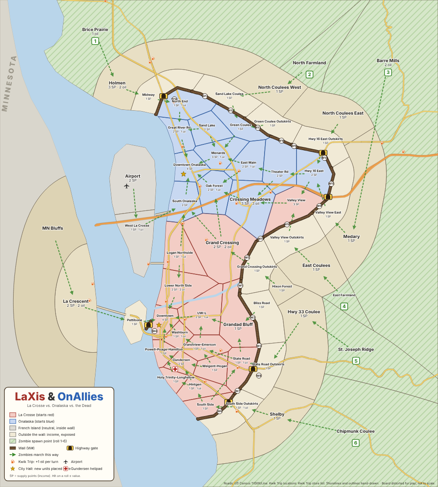

# LaXis & OnAllies

An area-control war game set in **La Crosse** and **Onalaska, Wisconsin**. La Crosse and Onalaska fight for control of both cities while a zombie outbreak closes in from the north, east and south. The mechanics come from Axis & Allies: purchase, combat move, combat, noncombat move, mobilize, and dice that hit on a roll at or under the unit's value.



## Play

- **Digital (hot-seat or vs. computer):** open [`game/index.html`](game/index.html) in a browser. It needs no install or server, and works offline. Two people can share a screen, or the computer can play either or both sides. The game autosaves in the browser, and you can also download a save file from the menu.
- **Tabletop:** print the files in [`print/`](print/):

| File | What it is |
|---|---|
| `board-poster-24x27.pdf` | The full board on one 24 × 27 inch sheet (print shop) |
| `board-tiled-letter.pdf` | The same board as letter-size tiles to trim and tape |
| `counters.pdf` | Infantry, tanks, the Gundersen Helicopter, the Onalaska Plane, zombies, stack chips, control markers, numbered wall pieces |
| `player-aid.pdf` | Turn sequence, unit chart, wall and zombie rules, setup table |
| `trackers.pdf` | Supply (SP), oil and round tracks |
| `rulebook.pdf` | The full rules ([HTML](docs/rules.html), [Markdown](docs/RULES.md)) |
| `board.svg` | Vector board for editing |

### Digital controls (modelled on TripleA)

| Action | Effect |
|---|---|
| Click a territory | Pick 1 unit to move (click again or click a unit icon: +1) |
| Double-click or Shift-click | Pick every unit there that can move |
| Ctrl-click a unit icon | Pick all units of that type |
| Right-click | Put 1 unit back (Shift-right-click or Esc clears) |
| Hover a bright territory | Preview the route |
| Click a bright territory | Move the picked units there |
| ↶ Undo move / Reset phase | Take back the last move / the whole phase |
| Battles | Roll a round, then each side picks its own casualties (pre-filled cheapest-first). "Fight to the end" auto-picks. The next-phase button stays grey until every battle is resolved. |
| Drag, scroll wheel, +/− | Pan and zoom |

## The game in one minute

- **The board:** 16 La Crosse neighborhoods, 12 Onalaska neighborhoods and 2 territories on French Island sit inside a wall. Three rings of territories surround them to the north, east and south, including Holmen, Midway, Medary, Shelby and Barre Mills. A three-territory spoke runs west across the Cass Street bridge: Pettibone, La Crescent and the Minnesota Bluffs.
- **Win:** own every territory inside the wall with no zombies inside, and hold that for a full round.
- **Units:** infantry, tanks (1 oil to move in a turn; oil comes from Kwik Trips), La Crosse's **Gundersen Helicopter** and Onalaska's **Plane** (also 1 oil to move in a turn). Aircraft can only be bought and flown while you hold the **airport on French Island**.
- **Zombies** attack at 3 and defend at 2. Each round, every one of the six outer-ring outskirts rolls round ÷ 2 dice (rounded up) on its own, and every 6 is a new zombie there. Zombies march **one ring inward per turn** with no decisions to make.
- **The wall and its gates:** there is no wall between the two cities. Your land units can leave or enter the city only at **highway gates**: WI-35 and US-53 north; I-90, WI-16 and State Road east; Mormon Coulee Road south; the Cass Street bridge west. A torn-down segment also lets units through. Zombies spend a turn next to the wall, tear it down the next turn, then walk in. Walls are never rebuilt. Units that stay put fire over intact walls, and the zombies can't hit back.
- **Rising dead:** units you lose when zombies beat you, or when you attack zombies and lose or retreat, become zombies.
- **Defeat:** end your turn without your City Hall and you're out. Your survivors turn, and **you command the horde** for the rest of the game.

## How the board was made

- **Roads:** US Census Bureau TIGER/Line 2025 primary and secondary roads for Wisconsin (public domain). They are stored in `tools/data/roads.geojson`.
- **Kwik Trips:** Kwik Trip's store list with coordinates, stored in `tools/data/kwiktrips.csv`. Only stations that sell gas count; the corporate campus does not.
- **Shorelines, the city outline and neighborhood seed points:** drawn by hand in `tools/board_config.py`. Their positions were checked against a georeferenced reference map: the Census roads were overlaid on it to confirm alignment, but no geometry was traced from it. La Crosse neighborhood names follow the city's neighborhood associations.
- `tools/build_map.py` does the geometry:
  1. Splits the city into Voronoi cells around the neighborhood seeds.
  2. Builds the three rings as distance bands from the wall, cut into sectors.
  3. Puts a wall on every inside/outside border, and marks a segment as a gate where a highway crosses it.
  4. Points every zombie arrow one step inward.
  5. Stretches the board slightly so the city core has room for pieces.
- `tools/build_print.js` renders the board, counters, player aid, trackers and rulebook with headless Chromium.

The board is a caricature, not a survey map: shapes are simplified and stretched, neighborhoods are centered on their main roads, and borders are approximate. Fonts: Patrick Hand and Bangers (SIL Open Font License, `game/fonts/`).

## Development

```sh
npm install                 # only needed for the rulebook (marked)
npm test                    # engine rules tests + generated-map invariants + AI self-play
pip install shapely pyshp    # map build dependencies
python3 tools/build_map.py  # regenerate game/js/mapdata.js from tools/board_config.py + tools/data/
node tools/build_print.js   # regenerate print/ and docs/rules.html (needs Playwright + Chromium)
node tools/simulate.js 200  # AI-vs-AI balance check
```

Code layout:

- `game/js/engine.js`: the complete rules as a pure state machine. It runs in Node and in the browser, with seeded dice.
- `game/js/ai.js`: a simple computer opponent, which the simulator also uses.
- `game/js/ui.js`, `game/index.html`, `game/css/style.css`: the browser interface.
- `game/js/mapdata.js`: the generated board.
